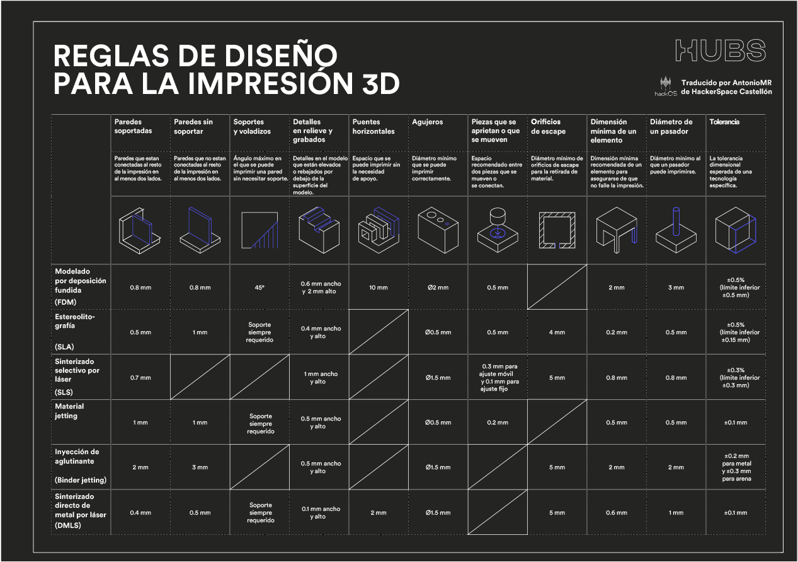

## **Microcurs: "Impressió 3D: Laminatge amb Prusa Slicer i modelatge paramètric amb Onshape"**

### Aplicació pràctica a la docència

Presentacions i fitxes del curs amb AlumniSAUJI del 24 i 26 de novembre i l'1 i 3 de desembre de 2026.

Descarrega els PDF i obre'ls amb Foxit PDF Reader.

<strong>Sessió 1 · Fonaments i PrusaSlicer bàsic</strong>

## <a href="https://drive.google.com/uc?export=download&id=1P0Pbd43o_g7_De__TJWyR8vxpkI5TI_R">**PRESENTACIÓ 1 (PDF)**</a>

## <a href="https://drive.google.com/uc?export=download&id=1-n6D3dnLOxem13cCVFWnpXkWYRjkKtg5">**FITXA 1.1 · SUPORT DE MÒBIL (PDF)**</a>

## <a href="https://drive.google.com/uc?export=download&id=1_gRp2xhS5blQyqvdtYm6E2dgpwQDSrdr">**FITXA 1.2 · PORTALLAPIS HACKCS (PDF)**</a>

<strong>Sessió 2 · PrusaSlicer avançat</strong>

Properament.

<strong>Sessió 3 · Disseny paramètric amb Onshape</strong>

Properament.

<strong>Sessió 4 · Dissenyar per imprimir, sense ensurts</strong>

Properament.

<figure>

<figcaption>

Regles de Disseny per a la Impressió 3D

</figcaption>

</figure>
