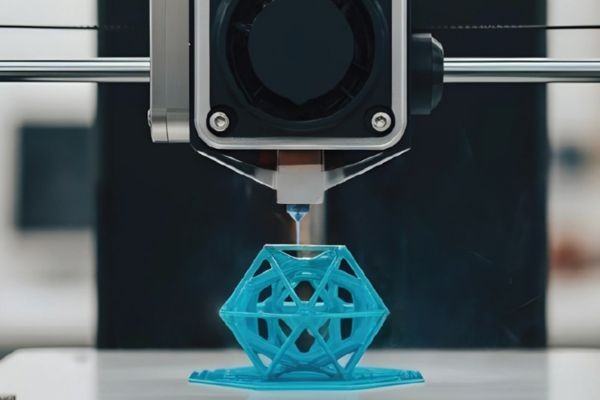

## **Microcurs: "Impressió 3D: Laminatge amb Prusa Slicer i modelatge paramètric amb Onshape"**

### Aplicació pràctica a la docència

Presentacions i fitxes del curs amb AlumniSAUJI del 24 i 26 de novembre i l'1 i 3 de desembre de 2026.

Descarrega els PDF i obre'ls amb Foxit PDF Reader.

<strong>Sessió 1 · Fonaments i PrusaSlicer bàsic</strong>

## <a href="https://drive.google.com/uc?export=download&id=1P0Pbd43o_g7_De__TJWyR8vxpkI5TI_R" target="_blank" rel="noopener noreferrer">**PRESENTACIÓ 1 (PDF)**</a>

## <a href="https://drive.google.com/uc?export=download&id=1-n6D3dnLOxem13cCVFWnpXkWYRjkKtg5" target="_blank" rel="noopener noreferrer">**FITXA 1.1 · SUPORT DE MÒBIL (PDF)**</a>

## <a href="https://drive.google.com/uc?export=download&id=1_gRp2xhS5blQyqvdtYm6E2dgpwQDSrdr" target="_blank" rel="noopener noreferrer">**FITXA 1.2 · PORTALLAPIS HACKCS (PDF)**</a>

<strong>Sessió 2 · PrusaSlicer avançat</strong>

## <a href="https://drive.google.com/uc?export=download&id=15U8gbaNQgrTbIvwpF8vH5t6b4WgwuxDw" target="_blank" rel="noopener noreferrer">**FITXA 2.1 · SUPORTS AMB HATY (PDF)**</a>

## <a href="https://drive.google.com/uc?export=download&id=1RasaU_5n61bhF0h4VWaVQYMCDtCzoKQv" target="_blank" rel="noopener noreferrer">**FITXA 2.2 · ORIENTAR I TALLAR EL BOLET HACKCS (PDF)**</a>

## <a href="https://drive.google.com/uc?export=download&id=1QyguvcYSCIgaL9enBtd_XD-eXY1cD4Co" target="_blank" rel="noopener noreferrer">**FITXA 2.3 · MODIFICADORS (PDF)**</a>

## <a href="https://drive.google.com/uc?export=download&id=121-HLBe0pqrwJp1XZ3wf4FQoH664P5hS" target="_blank" rel="noopener noreferrer">**FITXA 2.4 · CANVI DE COLOR PER CAPA (PDF)**</a>

## <a href="https://drive.google.com/uc?export=download&id=16AuIdJdIaoDHDaH8PqJmklNpHMVrF70g" target="_blank" rel="noopener noreferrer">**FITXA 2.5 · BASSES (PDF)**</a>

## <a href="https://drive.google.com/uc?export=download&id=1XqXNUCU6JWN40utWS8jsiOPiX4S_1WAw" target="_blank" rel="noopener noreferrer">**FITXA 2.6 · EL PES EN EL NOM (PDF)**</a>

## <a href="https://drive.google.com/uc?export=download&id=1n90XfzOGzHassxGAeR7eIhCqM63CbPQd" target="_blank" rel="noopener noreferrer">**FITXA 2.7 · PERFIL DE FILAMENT WINKLE (PDF)**</a>

<strong>Sessió 3 · Disseny paramètric amb Onshape</strong>

Properament.

<strong>Sessió 4 · Dissenyar per imprimir, sense ensurts</strong>

Properament.

<figure>

<figcaption>

Regles de Disseny per a la Impressió 3D

</figcaption>

</figure>
