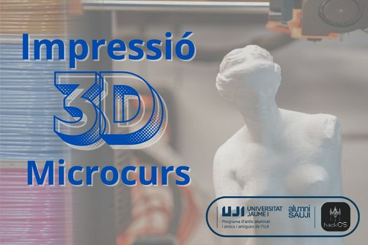

## **Microcourse: "3D Printing: Slicing with PrusaSlicer and Parametric Design with Onshape"**

Slides and worksheets from the AlumniSAUJI course on November 24 and 26 and December 1 and 3, 2026.

The worksheets have fields to write down your print times and grams: open them with Adobe Acrobat Reader.

### Session 1 · Fundamentals and PrusaSlicer basics

## <a href="https://drive.google.com/uc?export=download&id=1P0Pbd43o_g7_De__TJWyR8vxpkI5TI_R">**SLIDES 1 (PDF)**</a>

## <a href="https://drive.google.com/uc?export=download&id=1-n6D3dnLOxem13cCVFWnpXkWYRjkKtg5">**WORKSHEET 1.1 · PHONE STAND (PDF)**</a>

## <a href="https://drive.google.com/uc?export=download&id=1_gRp2xhS5blQyqvdtYm6E2dgpwQDSrdr">**WORKSHEET 1.2 · HACKCS PENCIL HOLDER (PDF)**</a>

### Session 2 · Advanced PrusaSlicer

Coming soon.

### Session 3 · Parametric design with Onshape

Coming soon.

### Session 4 · Designing for printing, without surprises

Coming soon.

<figure>

<figcaption>

Design Rules for 3D Printing

</figcaption>

</figure>
