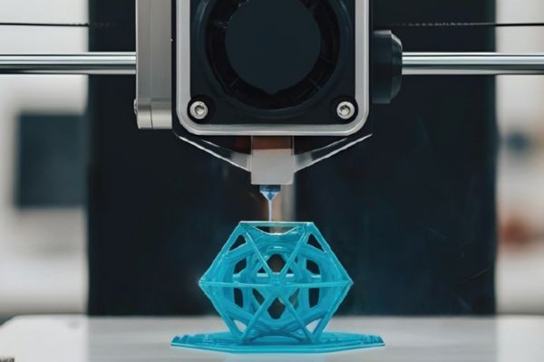
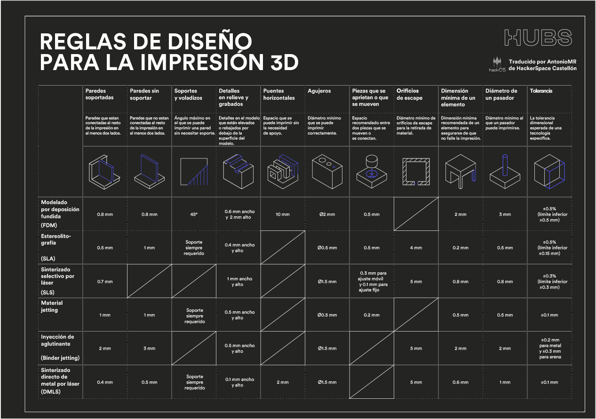

## **Microcourse: "3D Printing: Slicing with Prusa Slicer and Parametric Modeling with Onshape"**

### Practical application in teaching

Slides and worksheets from the AlumniSAUJI course on November 24 and 26 and December 1 and 3, 2026.

Download the PDFs and open them with Foxit PDF Reader.

<strong>Session 1 · Fundamentals and PrusaSlicer basics</strong>

## <a href="https://drive.google.com/uc?export=download&id=1P0Pbd43o_g7_De__TJWyR8vxpkI5TI_R" target="_blank" rel="noopener noreferrer">**SLIDES 1 (PDF)**</a>

## <a href="https://drive.google.com/uc?export=download&id=1-n6D3dnLOxem13cCVFWnpXkWYRjkKtg5" target="_blank" rel="noopener noreferrer">**WORKSHEET 1.1 · PHONE STAND (PDF)**</a>

## <a href="https://drive.google.com/uc?export=download&id=1_gRp2xhS5blQyqvdtYm6E2dgpwQDSrdr" target="_blank" rel="noopener noreferrer">**WORKSHEET 1.2 · HACKCS PENCIL HOLDER (PDF)**</a>

<strong>Session 2 · Advanced PrusaSlicer</strong>

## <a href="https://drive.google.com/uc?export=download&id=15U8gbaNQgrTbIvwpF8vH5t6b4WgwuxDw" target="_blank" rel="noopener noreferrer">**WORKSHEET 2.1 · SUPPORTS WITH HATY (PDF)**</a>

## <a href="https://drive.google.com/uc?export=download&id=1RasaU_5n61bhF0h4VWaVQYMCDtCzoKQv" target="_blank" rel="noopener noreferrer">**WORKSHEET 2.2 · ORIENTING AND CUTTING THE HACKCS MUSHROOM (PDF)**</a>

## <a href="https://drive.google.com/uc?export=download&id=1QyguvcYSCIgaL9enBtd_XD-eXY1cD4Co" target="_blank" rel="noopener noreferrer">**WORKSHEET 2.3 · MODIFIERS (PDF)**</a>

## <a href="https://drive.google.com/uc?export=download&id=121-HLBe0pqrwJp1XZ3wf4FQoH664P5hS" target="_blank" rel="noopener noreferrer">**WORKSHEET 2.4 · COLOR CHANGE BY LAYER (PDF)**</a>

## <a href="https://drive.google.com/uc?export=download&id=16AuIdJdIaoDHDaH8PqJmklNpHMVrF70g" target="_blank" rel="noopener noreferrer">**WORKSHEET 2.5 · RAFTS (PDF)**</a>

## <a href="https://drive.google.com/uc?export=download&id=1XqXNUCU6JWN40utWS8jsiOPiX4S_1WAw" target="_blank" rel="noopener noreferrer">**WORKSHEET 2.6 · WEIGHT IN THE FILE NAME (PDF)**</a>

## <a href="https://drive.google.com/uc?export=download&id=1n90XfzOGzHassxGAeR7eIhCqM63CbPQd" target="_blank" rel="noopener noreferrer">**WORKSHEET 2.7 · WINKLE FILAMENT PROFILE (PDF)**</a>

<strong>Session 3 · Parametric design with Onshape</strong>

Coming soon.

<strong>Session 4 · Designing for printing, without surprises</strong>

Coming soon.

<figure>

<figcaption>

Design Rules for 3D Printing

</figcaption>

</figure>
