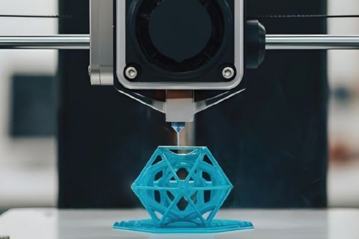
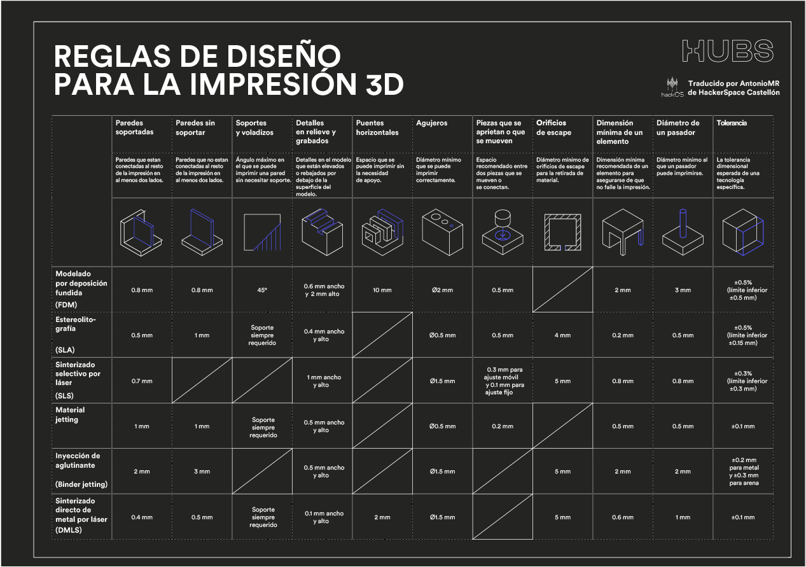

## **Microcurso: "Impresión 3D: Laminado con Prusa Slicer y modelado paramétrico con Onshape"**

### Aplicación práctica en la docencia

Presentaciones y fichas del curso con AlumniSAUJI del 24 y 26 de noviembre y el 1 y 3 de diciembre de 2026.

Descarga los PDF y ábrelos con Foxit PDF Reader.

<strong>Sesión 1 · Fundamentos y PrusaSlicer básico</strong>

## <a href="https://drive.google.com/uc?export=download&id=1P0Pbd43o_g7_De__TJWyR8vxpkI5TI_R" target="_blank" rel="noopener noreferrer">**PRESENTACIÓN 1 (PDF)**</a>

## <a href="https://drive.google.com/uc?export=download&id=1-n6D3dnLOxem13cCVFWnpXkWYRjkKtg5" target="_blank" rel="noopener noreferrer">**FICHA 1.1 · SOPORTE DE MÓVIL (PDF)**</a>

## <a href="https://drive.google.com/uc?export=download&id=1_gRp2xhS5blQyqvdtYm6E2dgpwQDSrdr" target="_blank" rel="noopener noreferrer">**FICHA 1.2 · PORTALÁPICES HACKCS (PDF)**</a>

<strong>Sesión 2 · PrusaSlicer avanzado</strong>

## <a href="https://drive.google.com/uc?export=download&id=15U8gbaNQgrTbIvwpF8vH5t6b4WgwuxDw" target="_blank" rel="noopener noreferrer">**FICHA 2.1 · SOPORTES CON HATY (PDF)**</a>

## <a href="https://drive.google.com/uc?export=download&id=1RasaU_5n61bhF0h4VWaVQYMCDtCzoKQv" target="_blank" rel="noopener noreferrer">**FICHA 2.2 · ORIENTAR Y CORTAR LA SETA HACKCS (PDF)**</a>

## <a href="https://drive.google.com/uc?export=download&id=1QyguvcYSCIgaL9enBtd_XD-eXY1cD4Co" target="_blank" rel="noopener noreferrer">**FICHA 2.3 · MODIFICADORES (PDF)**</a>

## <a href="https://drive.google.com/uc?export=download&id=121-HLBe0pqrwJp1XZ3wf4FQoH664P5hS" target="_blank" rel="noopener noreferrer">**FICHA 2.4 · CAMBIO DE COLOR POR CAPA (PDF)**</a>

## <a href="https://drive.google.com/uc?export=download&id=16AuIdJdIaoDHDaH8PqJmklNpHMVrF70g" target="_blank" rel="noopener noreferrer">**FICHA 2.5 · BALSAS (PDF)**</a>

## <a href="https://drive.google.com/uc?export=download&id=1XqXNUCU6JWN40utWS8jsiOPiX4S_1WAw" target="_blank" rel="noopener noreferrer">**FICHA 2.6 · EL PESO EN EL NOMBRE (PDF)**</a>

## <a href="https://drive.google.com/uc?export=download&id=1n90XfzOGzHassxGAeR7eIhCqM63CbPQd" target="_blank" rel="noopener noreferrer">**FICHA 2.7 · PERFIL DE FILAMENTO WINKLE (PDF)**</a>

<strong>Sesión 3 · Diseño paramétrico con Onshape</strong>

Próximamente.

<strong>Sesión 4 · Diseñar para imprimir, sin sustos</strong>

Próximamente.

<figure>

<figcaption>

Reglas de Diseño para la Impresión 3D

</figcaption>

</figure>
